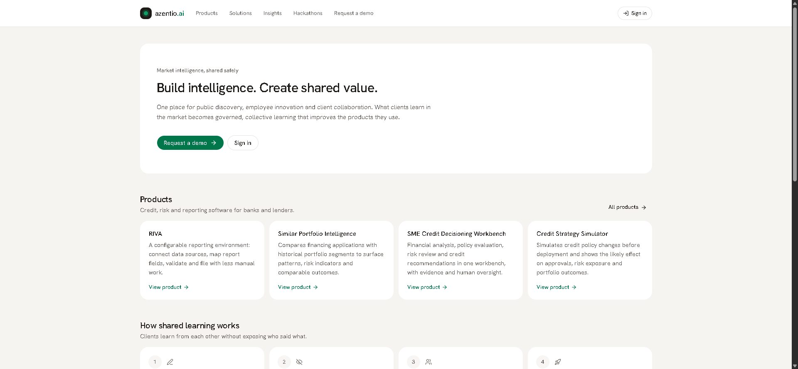
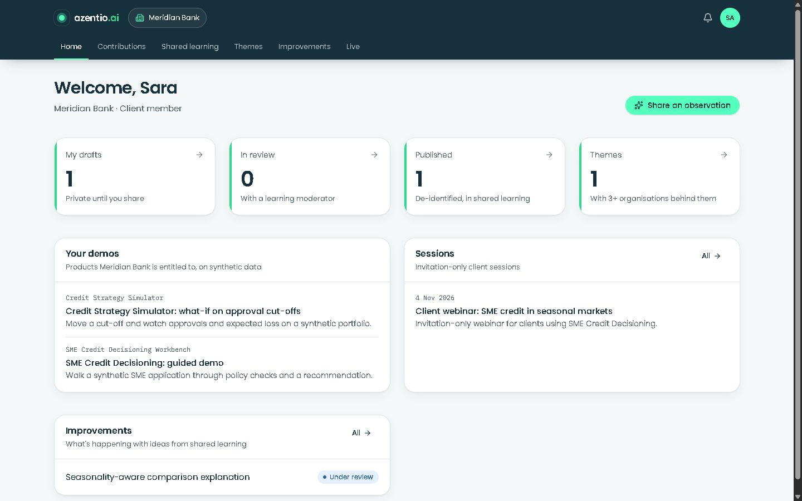
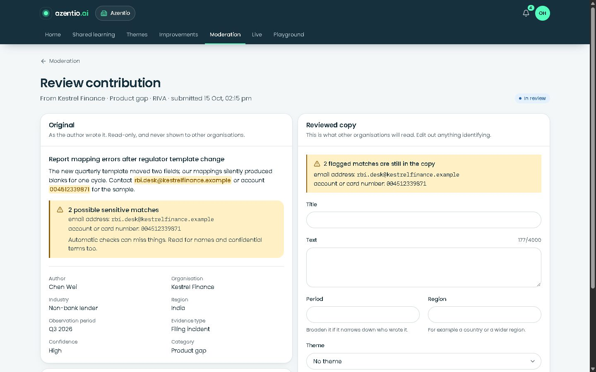
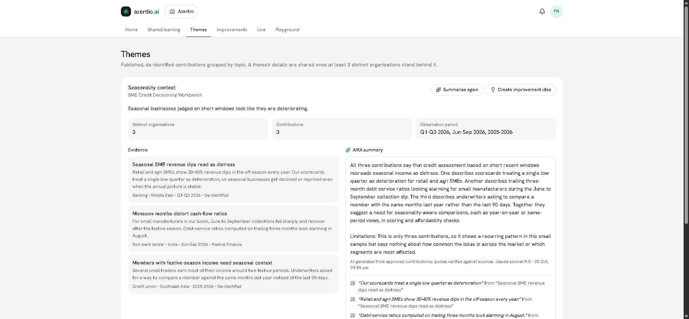
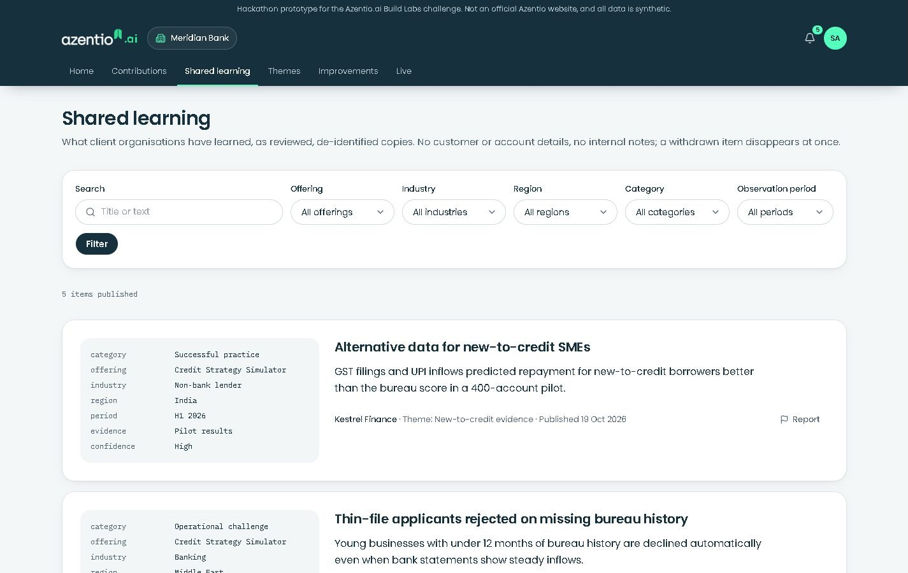
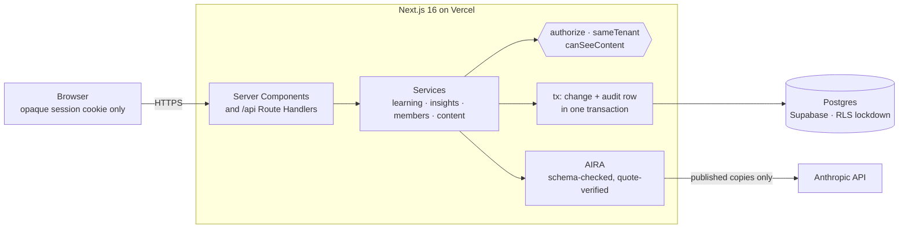

<div align="center">


# azentio.ai

**An enterprise AI website and a secure collaboration portal, where clients' market observations become governed,
shared learning that improves Azentio's products.**

[](https://azentio-platform.vercel.app)
[](https://nextjs.org)
[](https://react.dev)
[](tsconfig.json)
[](docs/adr/0002-postgres-everywhere-with-rls-lockdown.md)
[](tests/security.test.mjs)

[**Live demo**](https://azentio-platform.vercel.app) · [Security model](SECURITY.md) ·
[Requirements traceability](docs/requirements-traceability.md) · [Architecture](docs/architecture.md) ·
[Decision records](docs/adr/README.md)

<br>



</div>

---

Visitors explore Azentio's offerings and request demos. Employees and clients sign in to separate, exclusive
workspaces. Clients contribute market observations; moderators publish de-identified copies; product teams turn the
recurring themes into improvement ideas. Every step is governed by consent, enforced on the server, and audited.

Built for the **Azentio.ai Build Labs Special Challenge**.

## How it works, in one story

Banks notice market problems first, and if they shared what they see, Azentio could build better products for all of
them. But banks compete, so they share only when it's safe: nobody can tell who said what, and they can take it back.
azentio.ai is that safe place, a suggestion box for competing banks with a careful editor in the middle. All the
people and banks below are fictional demo personas.

1. **Sara** at Meridian Bank notices that seasonal shops get flagged as risky in their off-season. She writes it down:
   a private draft only she can see.
2. She proposes it for sharing and allows a reviewed copy to be published, without her bank's name.
3. **Omar**, Azentio's moderator, removes a phone number she left in and publishes a separate, clean copy. Her
   original stays private.
4. **Chen** at Kestrel Finance, another bank, reads the copy and recognises the same problem, with no idea who wrote it.
5. Once three different banks have said something similar, it becomes a theme. Below three, it stays hidden, so no
   single bank can be singled out.
6. **AIRA**, the AI assistant, summarises the theme, quoting the contributions word for word, or it saves nothing.
7. **Priya**, a product owner, turns the theme into an improvement idea, and the banks get a plain status update.
8. Sara can withdraw her note at any time, and it disappears from the feed, search and AI summaries at once.

Banks get better products and early warning without exposing themselves; Azentio gets real market insight; and
everyone can check that the server enforces every rule. Even Azentio's portal administrator can't read a bank's notes.

## Why it's different

- **Access is decided on the server, for every request.** One deny-by-default `authorize()` decides every action from
  the active membership's roles. Another organisation's record answers `404`, even through a direct API call. The UI
  only hides what the server would refuse anyway.
- **Private by default, consent per purpose.** Saving never shares. Publishing a shared copy, showing the
  organisation's name and future model training are separate consents with history. Joining a workspace is never
  consent.
- **The shared copy is a different record.** Moderators publish a reviewed copy that has no tenant, author or notes in
  it. Publication is blocked while it still contains an email, phone, account number, PAN or IBAN.
- **Withdrawal means gone.** Withdrawing removes the contribution from the feed, search and every AI summary that
  cited it, in one transaction.
- **Small numbers stay hidden.** A theme needs contributions from at least three distinct organisations before any
  count, evidence or summary is shown.
- **AI that can only say what the evidence shows.** AIRA reads approved copies only, answers in a validated schema, and
  every quote is checked against its source. A summary that can't be backed is thrown away.

## See it

| | |
|---|---|
|  |  |
| **Client workspace:** only this organisation's entitled demos, sessions and improvement status | **Moderation:** original beside the reviewed copy; flagged identifiers block publication until removed |
|  |  |
| **Themes:** three organisations behind it, de-identified evidence, AIRA summary with verified quotes | **Shared learning:** reviewed copies only, searchable and reportable |

**Try it in two minutes** on the [live demo](https://azentio-platform.vercel.app): sign in as Sara and propose an
observation → as Omar, publish a redacted copy → as Chen, find it in shared learning → as Priya, summarise the
*Seasonality context* theme with AIRA → as Sara, withdraw it and watch it disappear everywhere. The full walkthrough
is in [docs/demo-script.md](docs/demo-script.md).

## Personas

All accounts and data are synthetic. In demo mode the one-time sign-in code appears on screen, because no email
provider is connected.

| Persona | Email | Can |
|---|---|---|
| Client member, Meridian Bank | `sara@meridianbank.example` | Contribute, read shared learning, follow improvements |
| Client admin, Meridian Bank | `ravi@meridianbank.example` | The above, plus invite and revoke members of Meridian only |
| Client member, Kestrel Finance | `chen@kestrelfinance.example` | Kestrel's workspace only |
| Adviser in two client workspaces | `maya@advisory.example` | Switch between Kestrel and Harbourline, one at a time |
| Learning moderator | `omar@azentio.com` | Review, redact, publish, return, decline; handle reports |
| Product owner | `priya@azentio.com` | Run AIRA on themes; create and progress improvement ideas |
| Content publisher | `lena@azentio.com` | Publish broadcasts and content to chosen audiences |
| Employee | `dev@azentio.com` | Internal experiments, broadcasts, playground |
| Portal administrator | `admin@azentio.com` | Organisations, roles, audit log; **no** access to client contributions |

## Architecture

One Next.js application. Pages and the API call the same services, and every service starts with the same
`authorize()`; there is no second backend to drift out of step.



More diagrams (request lifecycle, data model, contribution and shared-copy lifecycles, AIRA pipeline) are in
[docs/architecture.md](docs/architecture.md); the reasoning behind each choice is in the
[decision records](docs/adr/README.md).

## Coverage of the brief

Every requirement is mapped to the code that enforces it and the test that proves it in
[docs/requirements-traceability.md](docs/requirements-traceability.md), including what is partial and what is
still open.

| Brief section | Delivered |
|---|---|
| 03 Personas and access (IAM-01, IAM-02) | Seven roles with separate grants; tenant, audience and entitlement checks on every protected resource; explicit active workspace |
| 04 Login and onboarding | Email one-time codes; single-use, expiring invitations bound to the invited address; no trusted tenant from an arbitrary email |
| 05 Employee portal | Dashboard, internal experiments, employee-only broadcasts, synthetic-data playground, improvement ideas |
| 06 Client portal | Active organisation, entitled demos and sessions, my and my organisation's observations, filtered shared feed, member administration, improvement status |
| 07 Observation capture | Structured form, private drafts, server-side validation, sensitive-content prompts and scanning |
| 08 Review and withdrawal | Audited state machine, separate shared versions, re-review on material edits, reports, withdrawal in one transaction, in-app notifications |
| 09 Sharing and consent | Three visibility levels, four consent purposes with history, opt-in attribution, safe payloads, minimum-organisation suppression |
| 10 Insights and improvement | Themes counted by distinct organisation, AIRA synthesis with verified citations, improvement ideas with audited statuses |
| 11 Federated learning (optional P2) | Out of scope; stated, not simulated |

## Security

| Control | Where |
|---|---|
| Deny by default, one policy module | `src/server/policy.ts` |
| Tenant isolation: another tenant's record is `404` | `sameTenant()` |
| Audience and entitlement checks on content | `canSeeContent()` |
| Shared copies carry no tenant, author or notes | `shared_versions`, `sharedFeed()` |
| Hashed one-time codes, `__Host-` HttpOnly session cookie, revocation on the next request | `src/server/auth.ts` |
| Same-origin check on every write; nonce-based CSP (no inline scripts) and strict security headers | `src/server/http.ts`, `src/proxy.ts`, `next.config.ts` |
| Supabase's public API locked: RLS on every table, `anon` grants revoked | `LOCKDOWN` in `src/server/db.ts` |
| Every state change audited in the same transaction, hash-chained for tamper evidence | `src/server/audit.ts`, `audit-chain.ts`, `tx()` |

30 black-box tests sign in as different personas and attack the API directly (cross-tenant reads and writes, role
escalation, private drafts, payload contents, withdrawal, revocation, CSRF, malformed input on every write route).
CI runs them against a production build on every pull request. The threat model (STRIDE), OWASP Top 10 mapping, what is
simulated and the known limitations are in [SECURITY.md](SECURITY.md).

## Quick start

```bash
git clone https://github.com/Sharon-rosario/azentio-platform.git && cd azentio-platform
npm install
npm run dev    # http://localhost:3000: creates and seeds an embedded Postgres in ./data, no set-up needed
```

| Command | What it does |
|---|---|
| `npm test` | Unit tests: sensitive-content scanner, quote verification, redirect checks |
| `npm run test:security` | With the dev server running: the 30 API security tests |
| `npm run typecheck && npm run lint` | Type and lint checks, as in CI |
| `npm run reset` | Wipe local data; it's re-seeded on the next request |

Requires Node.js 20.9 or newer (CI uses 24). AIRA uses the Claude Code CLI if you're signed in to it, or the API if
`ANTHROPIC_API_KEY` is set (see [`.env.example`](.env.example)).

## Deploy (Vercel + Supabase)

1. Create a Supabase project and copy the **transaction pooler** connection string (port 6543).
2. Import the repository into Vercel and set `DATABASE_URL` (the pooler URI), `SESSION_SECRET` (32+ random characters,
   `openssl rand -hex 32`), `ANTHROPIC_API_KEY`, and `DEMO_MODE=1` only for a judging environment.
3. Put Vercel's Function Region next to the database, and deploy. The schema, the RLS lockdown and the synthetic data
   are created on the first request.

## Project layout

```
src/
  app/(site)/        public website: products, solutions, insights, connect, hackathon, security
  app/portal/        signed-in portal: workspace, contributions, moderation, themes, ideas, members, admin
  app/api/           Route Handlers, one per resource, all through route()
  server/            services and the security core (server-only): policy, auth, learning, insights, members, db
tests/               API security suite and unit tests
docs/                architecture, demo script, decision records, requirements traceability
```

## Tech stack

| Layer | Choice |
|---|---|
| Application | Next.js 16 (App Router, Server Components, Route Handlers), React 19, TypeScript (strict) |
| UI | Tailwind CSS 4, shadcn/ui on Base UI, lucide icons |
| Design | Azentio's brand (navy, mint, Poppins) from one token file, [`src/app/theme.css`](src/app/theme.css); one contrast-checked light theme |
| Data | Postgres: Supabase in production, PGlite (embedded Postgres) locally |
| AI | Anthropic Claude via the API in production, Claude Code CLI locally; zod-validated structured output |
| Hosting | Vercel |

## Responsible AI and disclosure

AIRA is Anthropic's Claude, used only to summarise approved, de-identified contributions. Its output is labelled,
grounded in verified quotes and never drives an action. This codebase was built with the help of AI coding tools
(Claude Code), as the challenge rules allow.
