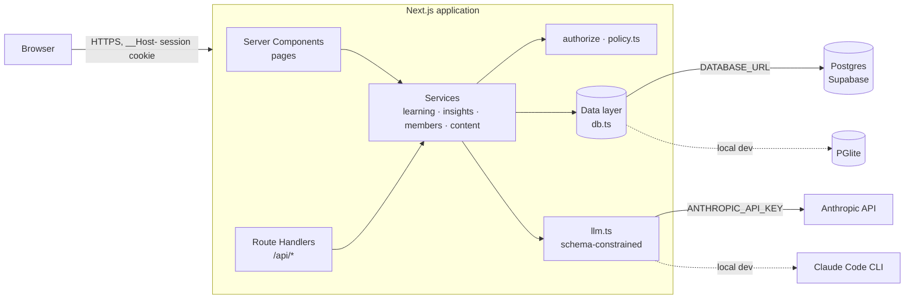
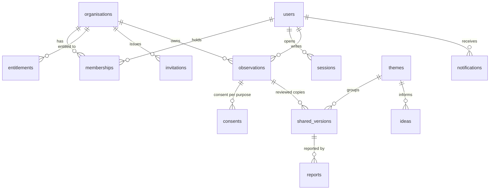
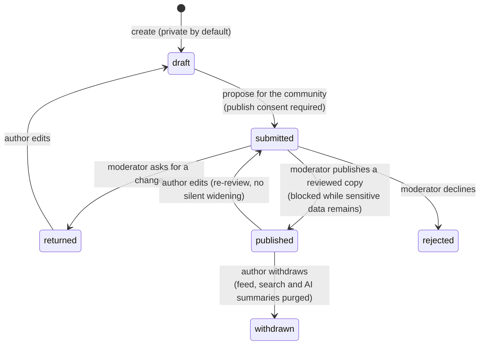
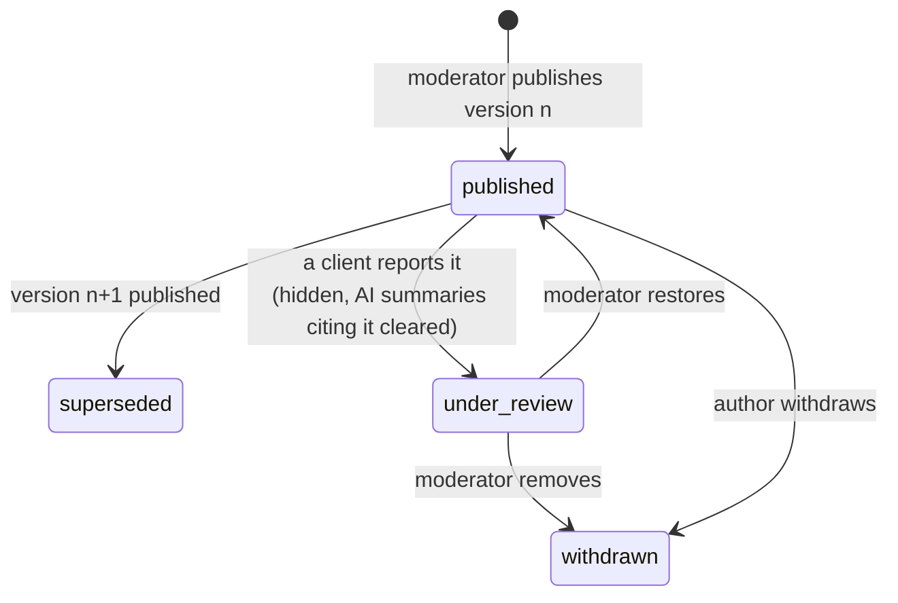

# Architecture

One Next.js 16 application: React Server Components render pages, Route Handlers expose the API, and both call the
same server-side services. There is no separate backend to keep in sync and no client-side authority: the browser
holds an opaque session cookie and nothing else.



## Request lifecycle

1. **Session.** `getPrincipal()` hashes the cookie's opaque id, loads the session, the user and all *active*
   memberships, and picks the active workspace. Revoked memberships drop out here, on every request.
2. **Permission.** The service calls `authorize(principal, permission)`; the permission set is derived from the active
   membership's roles only. No permission, no data.
3. **Tenant and audience.** Tenant-owned rows are compared with the active organisation (`sameTenant`, 404 on
   mismatch); content is filtered by audience and entitlement.
4. **Write.** State changes run inside `tx()`, which writes the audit row in the same transaction.
5. **Response.** Route Handlers return JSON through one wrapper (`route()`), which also enforces same-origin on writes
   and maps errors to `{detail}`. Pages use `load()`, which maps 401 to the sign-in page, 403 to an explanation and 404
   to not-found.

## Data model



`observations` is the private source and never leaves its organisation. `shared_versions` is the only representation
other organisations can read, and it carries no tenant id, author or moderator note.

## Contribution lifecycle

The private source (`observations`):



The author can withdraw from any state; the diagram shows the one that matters (a live shared copy).

Each publication writes a new reviewed copy (`shared_versions`), numbered per contribution:



Only `published` copies appear in the feed, search, filters, theme counts and AIRA's sources.

## AIRA synthesis pipeline

```mermaid
sequenceDiagram
    participant PO as Product owner
    participant S as insights.ts
    participant M as Model
    PO->>S: Summarise theme
    S->>S: authorize(themes.synthesize)
    S->>S: published copies only; ≥ 3 organisations?
    S->>M: delimited contributions + JSON Schema
    M-->>S: {summary, limitations, citations[]}
    S->>S: zod validation (fail closed)
    S->>S: verify each quote against its source
    S->>S: save with verified citations + audit row
    S-->>PO: summary, citations, model, time
```

## Environments

| | Local development | Production (Vercel) |
|---|---|---|
| Database | PGlite in `data/pg` (embedded Postgres, no install) | Postgres via `DATABASE_URL` (Supabase transaction pooler) |
| Model | Claude Code CLI (signed-in account) | Anthropic API via `ANTHROPIC_API_KEY` |
| Session secret | Generated once into `data/secret` | `SESSION_SECRET` (required; start-up fails without it) |
| Demo personas and on-screen codes | On | Off unless `DEMO_MODE=1` |

The schema is created idempotently on first connection and an empty database is seeded with synthetic data.

## Repository layout

```
src/
  app/
    (site)/          public website (products, solutions, insights, connect, hackathon, security)
    portal/          signed-in portal (role-aware top panel)
    login/, invite/  sign-in and invitation acceptance
    api/             Route Handlers, one per resource, all through route()
  server/            services and the security core (server-only)
    policy.ts        roles, permissions, authorize(), tenant and audience rules
    auth.ts          email codes, sessions, principal, workspaces
    http.ts          route() wrapper: same-origin check, input parsing, one error shape
    page.ts          load() for server pages: 401 → sign-in, 403 → explanation, 404 → not found
    learning.ts      contributions, consent, moderation, shared feed, reports, withdrawal
    insights.ts      themes, suppression, AIRA, improvement ideas
    members.ts       invitations, roles, revocation, audit log, notifications
    content.ts       audience- and entitlement-filtered content, public forms
    scan.ts          sensitive-content detector (emails, phones, account numbers, PAN, IBAN)
    evidence.ts      quote verification for AIRA citations
    llm.ts           schema-constrained model calls, fail closed
    audit.ts         append-only audit rows and in-app notifications
    db.ts, seed.ts   Postgres data layer, RLS lockdown and synthetic seed
  lib/safe-path.ts   same-origin redirect check
  components/        UI (design system in src/app/globals.css)
tests/
  security.test.mjs  black-box API security suite (24 tests, run against a live server)
  unit.test.mjs      scanner, quote verification and redirect checks
docs/
  adr/               architecture decision records
```

## Further reading

- [Architecture decision records](adr/README.md): why the system is shaped this way, one decision per page.
- [Requirements traceability](requirements-traceability.md): every requirement in the brief, where it's enforced and
  which test proves it.
- [SECURITY.md](../SECURITY.md): security model, threat model and known limitations.
